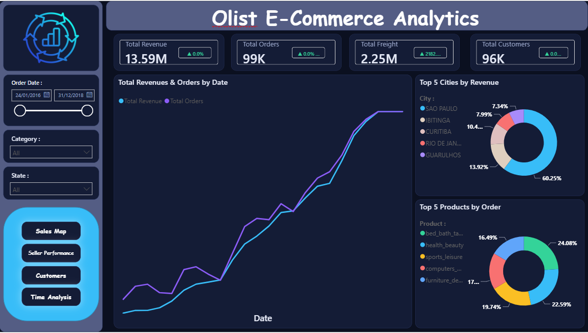
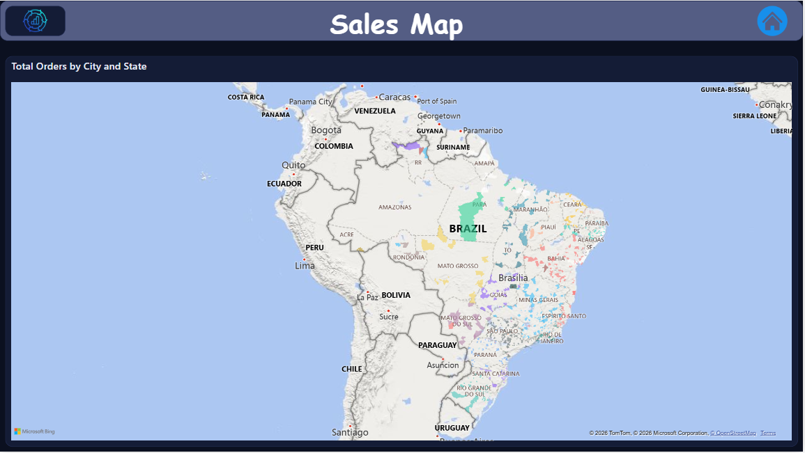
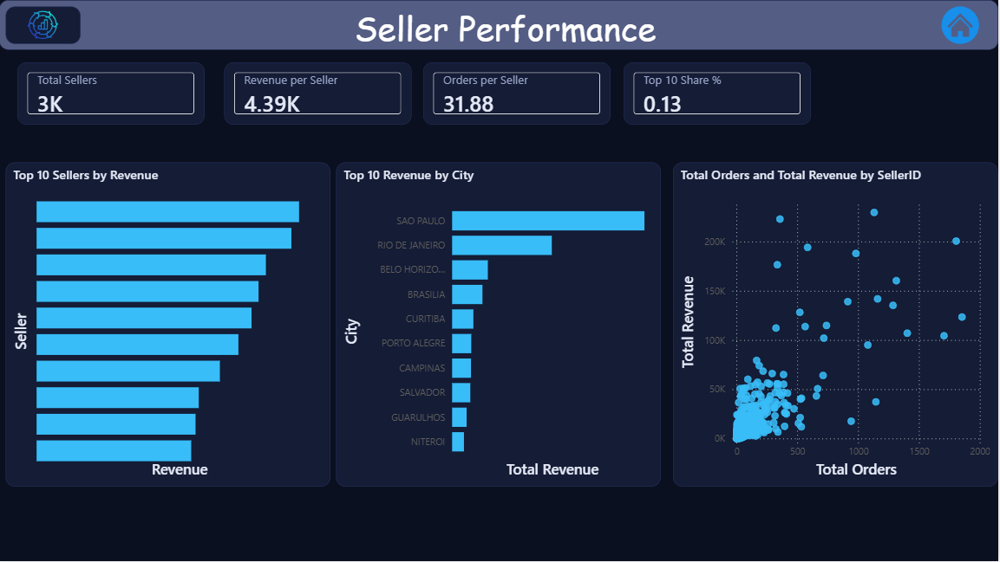
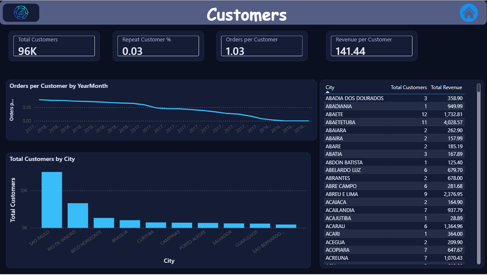
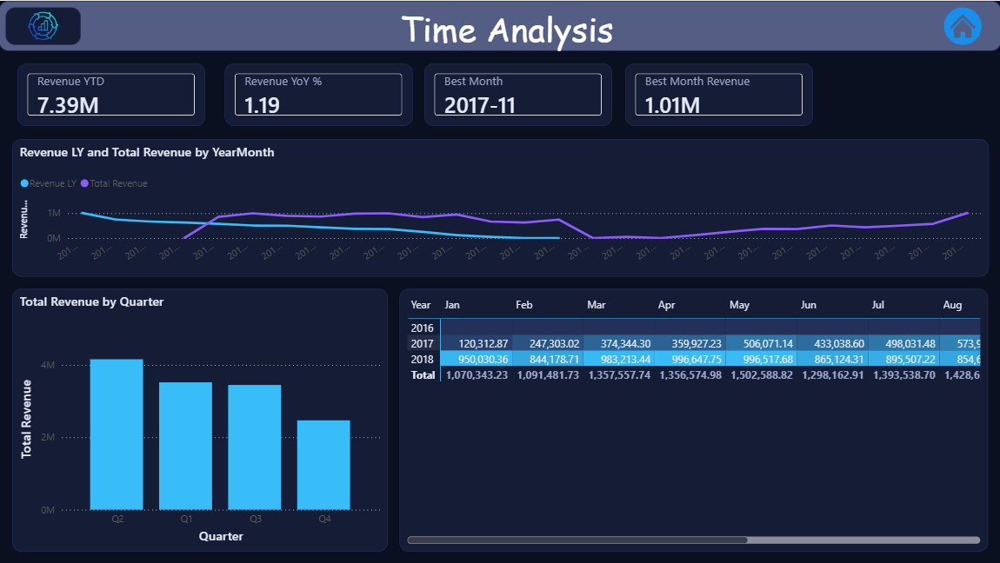

# Olist E-Commerce Analytics

An end-to-end analytics project on the Brazilian Olist e-commerce dataset: raw CSV files → SQL Server staging → Informatica ETL → star-schema data warehouse → interactive Power BI dashboard.

**Portfolio page:** https://mo3azfaroog.github.io/project-olist.html



## Project Overview

Olist is a Brazilian marketplace that connects small sellers to customers. This project turns the raw public dataset (9 CSV files, 2016–2018) into a clean dimensional model and a multi-page dashboard that answers questions such as:

- How much revenue, how many orders and customers, and how much freight cost is the marketplace generating?
- Which states and cities drive the most sales?
- Which product categories and sellers perform best?
- How does revenue change over time, and when are the seasonal peaks?

## Architecture

```
Olist CSV files (Kaggle)
        │
        ▼
SQL Server – OlistDB (stg schema)      ← data profiling & staging
        │
        ▼
Informatica                            ← ETL (cleaning, transformation, loading)
        │
        ▼
Data Warehouse (star schema, dw schema)
        │
        ▼
Power BI                               ← data model, DAX measures, dashboard
```

## Tech Stack

| Layer | Tool |
|---|---|
| Source data | Kaggle – Brazilian E-Commerce Public Dataset by Olist |
| Staging & warehouse | SQL Server, SSMS |
| ETL | Informatica |
| Modeling | Star schema (dimensional modeling) |
| Visualization | Power BI Desktop, DAX |

## Data Model

Star schema with one fact table and four dimensions:

| Table | Description | Key columns |
|---|---|---|
| `FactSales` | One row per order item | SalesKey, OrderID, CustomerKey, SellerKey, ProductKey, PurchaseDateKey, Price, FreightValue |
| `DimCustomer` | Customer attributes | CustomerKey, CustomerID, CustomerUniqueID, City, State, ZipCodePrefix |
| `DimSeller` | Seller attributes | SellerKey, SellerID, City, State, ZipCodePrefix |
| `DimProduct` | Product attributes | ProductKey, ProductID, CategoryNameEnglish, WeightG, PhotosQty |
| `DimDate` | Calendar table (2016–2018) | Date, DateKey, Year, Quarter, QuarterNo, Month, MonthNo, YearMonth |

All DAX measures live in a dedicated `_Measures` table.

## Dashboard Pages

| | |
|---|---|
| **1. Executive Summary** – headline KPIs with month-over-month indicators, revenue and orders trend, top 5 cities by revenue, top 5 product categories by orders, and slicers for date, category and state. |  |
| **2. Sales Map** – total orders by state and city on a map of Brazil. |  |
| **3. Seller Performance** – total sellers, revenue and orders per seller, top 10 sellers, top 10 cities by revenue, and orders versus revenue per seller. |  |
| **4. Customers** – customer counts, repeat-customer rate, orders and revenue per customer, customers by city. |  |
| **5. Time Analysis** – Revenue YTD, year-over-year growth, best month, revenue versus last year, revenue by quarter and a year × month matrix. |  |

## Key Headline Numbers

| Metric | Value |
|---|---|
| Total Revenue | 13.59M |
| Total Orders | 99K |
| Total Freight | 2.25M |
| Total Customers | 96K |
| Repeat Customer % | about 3% |

## Selected DAX Measures

```DAX
Revenue LY = CALCULATE([Total Revenue], SAMEPERIODLASTYEAR(DimDate[Date]))

Revenue YoY % = DIVIDE([Total Revenue] - [Revenue LY], [Revenue LY])

Revenue YTD = TOTALYTD([Total Revenue], DimDate[Date])

Revenue PM = CALCULATE([Total Revenue], DATEADD(DimDate[Date], -1, MONTH))

Best Month =
CONCATENATEX(
    TOPN(1, VALUES(DimDate[YearMonth]), [Total Revenue], DESC),
    DimDate[YearMonth],
    ", "
)

Repeat Customer % = DIVIDE([Repeat Customers], [Unique Customers])
```

## Design Choices

- Dark theme with a consistent header, logo and home-button navigation across pages.
- Star schema for fast, simple DAX and clean filter propagation.
- Date table marked as a date table, with month and quarter names sorted by their numeric columns.
- Measures organized in a separate `_Measures` table, with colour and text measures driving the KPI change indicators.

## Insights

- Revenue grows sharply from early 2017 through 2018, reflecting the marketplace's rapid expansion.
- November 2017 is the strongest month, likely driven by Black Friday demand.
- A large share of revenue is concentrated in a few cities, led by São Paulo.
- Only about 3% of customers placed more than one order.

## Repository Contents

```
Brazilian E-Commerce.pbix   Power BI report
Dashboard/                  Screenshots of the five report pages
dataset/                    Source data notes and the smaller source files (see dataset/README.md)
```

The report file contains the loaded data. Refreshing it requires access to the original SQL Server data warehouse.

## Roadmap

- Add the SQL scripts (staging tables and warehouse objects) and the Informatica mapping exports to this repository.
- Delivery Performance page: on-time delivery %, average delivery days and delay analysis (needs delivery and estimated-delivery dates in the warehouse).
- Payments and Reviews page: revenue by payment type and review-score distribution (needs payments and reviews tables in the warehouse).
- Tooltip pages, drill-through and bookmarks.

## Data Source and Credit

Data: [Brazilian E-Commerce Public Dataset by Olist](https://www.kaggle.com/datasets/olistbr/brazilian-ecommerce) on Kaggle (CC BY-NC-SA 4.0).

## Author

**Muaz Faroug** – Data Analyst (Power BI, DAX, Power Query, SQL Server, Excel), Riyadh, Saudi Arabia.
Portfolio: https://mo3azfaroog.github.io · LinkedIn: https://www.linkedin.com/in/moaz-faroog
